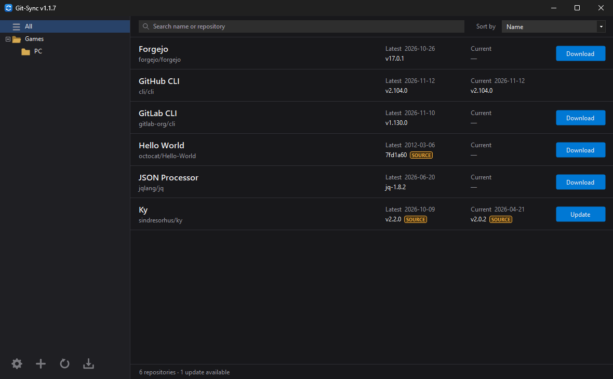

# Git-Sync

A small Windows app that keeps track of new releases on GitHub, GitLab, Codeberg and
self-hosted Forgejo / Gitea / GitLab servers, sorts the repositories you follow into
folders of your own, and downloads the releases you pick.



## Features

- **Your own folder tree.** Create folders and subfolders in Settings (for example
  *Games › PC*) and file each repository under one. Selecting a folder lists its
  repositories and those of every folder below it.
- **Search.** The box above the list (**Ctrl+F**) narrows it to the repositories whose name
  or `owner/repo` has every word typed, inside the selected folder, or everywhere under *All*.
- **Latest / Current at a glance.** Refresh checks every repository (or only the selected
  folder) and shows the newest version next to the one you have; while it checks, the button
  turns into **Stop**. Repositories that publish
  no files are marked **SOURCE** and get their source archive instead; a repository that
  could not be checked shows a red ✕ with the reason.
- **Download and Update.** A release with one file downloads straight away; with several,
  you pick which ones, and the next update pre-selects the same files. **Update All** walks
  through every repository with a newer version, one at a time.
- **Redownload.** Right-click → *Redownload…* lists the files of the version you have again,
  so a wrong pick can be fixed: tick the right file, untick the wrong one and it is deleted.
- **Source code too.** Settings → Automation → *Show source code when downloading* lists each
  release's Source code (zip) and (tar.gz) with its other files.
- **Automatic checks.** Settings → Automation can check every repository on its own, every
  30 minutes to 12 hours.
- **Export and import.** Settings → Data saves your repositories and their folders to a JSON
  file, and imports such a file into another install, folder by folder: into the same folder,
  one of yours, or not at all. Repositories already in the list are skipped. Tokens are never
  exported.
- **Check Files.** Settings → Data lists the downloaded files that are no longer on disk, and
  anything in the download folder that belongs to no repository.
- **Version in every file name.** Files are saved as `name (build-212).zip`, so builds that
  only differ by a hash can be told apart. The repository's `README.md` is saved beside them.
- **Keep previous versions** per repository, or let each update replace the old files. Keep
  them all, or only the last few: past that number, the oldest version's files are deleted.
  Settings → Automation → *Move previous versions to a different folder* puts them in an `Old`
  folder, so the repository's folder holds only the newest version. Only files Git-Sync
  downloaded itself are ever deleted.
- **Pin a version.** Right-click → *Versions* lists every release on the site; pick an older
  one to stay on it.
- **Add by link.** Drag a repository link from the browser onto the window, or press
  **Ctrl+V** with one copied. Self-hosted servers are recognised automatically.
- **Tokens and limits.** Settings → Sites takes a token per site and shows how many API
  requests are left.
- **Its own updates.** At launch, Git-Sync asks GitHub whether a newer version of itself is
  out and offers to open the releases page. *Skip update* stops the reminders until the next
  version; Settings → Automation → *Check for updates on launch* turns the check off.
- **Portable.** One self-contained `Git-Sync.exe` (no .NET install needed). Its database,
  `Git-Sync.db`, and the downloads, under `Apps\<folder path>\<repository folder>\`, live
  beside it. Renaming a repository's folder or changing its filter moves the downloads along,
  and so does renaming or moving a folder in Settings → Filters. A repository's *Folder* can
  hold subfolders (`Emulators\Ky`), even inside another repository's folder — each keeps its
  own files and its own `Old`. *Custom folder* in its Edit window puts it anywhere on disk,
  outside the download folder.
- **Download folder.** Settings → Data → *Use custom download folder* sends the downloads to
  another folder, on any drive, instead of `Apps`. Switching asks whether to move what is
  already downloaded along, or to leave it where it is.

> `Git-Sync.db` holds your tokens in plain text. Keep it private when you copy the folder.

## Building

Requires Windows and the [.NET 10 SDK](https://dotnet.microsoft.com/download).

```
dotnet publish Git-Sync.csproj -c Release -o <output folder>
```

The output folder must be outside this folder (see `Directory.Build.props`).

## Tests

The `tests` folder holds a console test bench that compiles the same source files.

```
cd tests
dotnet run                # offline checks
dotnet run -- --online    # also queries GitHub, GitLab, Codeberg and a self-hosted Forgejo
```
